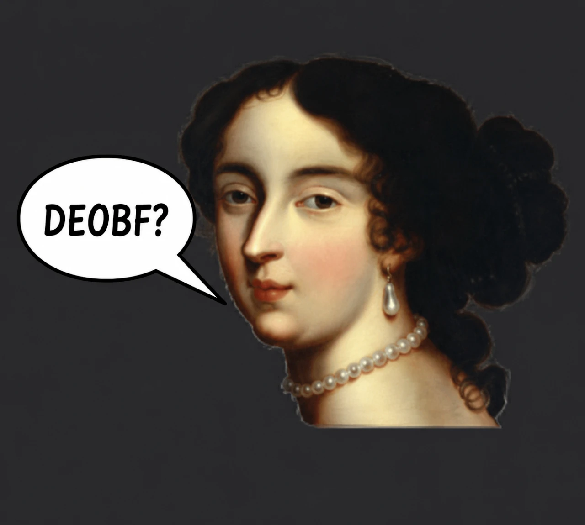

# Open Prestige


<p align="center">
  
  
</p>

<p align="center">
  
</p>


## Run

```
run.bat
```

`run.bat` starts the dev client (offline) and writes everything to `logs\run_<time>.log`
(plus a copy of `latest.log` and any crash report). Open the ClickGUI with the menu key (default `RIGHT SHIFT`).

Open in IntelliJ: File > Open > this folder (`build.gradle`), "Open as Project", Gradle JVM = JDK 21,
then use the generated **Minecraft Client** run configuration.

Build a self-contained mod jar (imgui-java + natives and ClassTransform are bundled):

```
gradlew build
```

